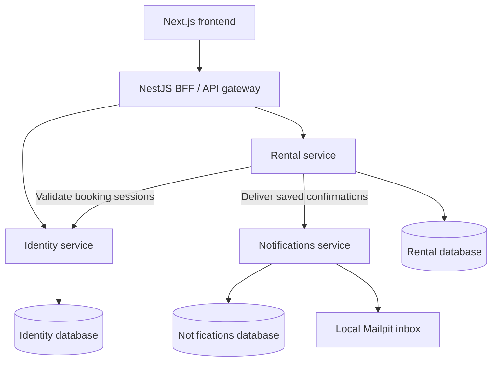

# Handoff — Current State

Updated October 27, 2026. This describes the implemented application, not the older
microservices design or a future deployment.

## Architecture

Handoff has **three domain microservices**—Identity, Rental and Notifications—behind
a separate, thin API gateway. Each domain service owns its database. The gateway
has no database client or database credentials. The application is a **frontend +
BFF/API gateway + three domain microservices**; the architecture migration is complete.



| Component | Implementation | Responsibility |
| --- | --- | --- |
| Web | `apps/web`: Next.js, React, TypeScript, Tailwind CSS | Account UI, search, checkout, history and receipts |
| Gateway | `apps/bff`: NestJS | Public routes, browser cookies/origin checks, Identity auth and forwarding to Rental |
| Rental | `apps/rental`: NestJS and Prisma | Inventory, pricing, availability, bookings, receipts and notification outbox |
| Identity | `apps/identity`: NestJS and Prisma | Accounts, passwords, sessions and internal session validation |
| Identity database | Separate PostgreSQL 17 instance/database | Users, hashed credentials/sessions and import marker |
| Notifications | `apps/notifications`: NestJS, Prisma and Nodemailer | Idempotent confirmation acceptance, SMTP delivery and retries |
| Rental database | PostgreSQL 17, existing `refdata` database | Locations, vehicles, bookings and rental outbox; inactive legacy identity archives |
| Notifications database | Separate PostgreSQL 17 instance/database | Accepted confirmations and delivery state |
| Inbox | Mailpit | Captures actual SMTP messages locally |
| Contracts | `libs/contracts`: Zod and TypeScript | Shared public and internal request/response validation |

There are five application processes: frontend, gateway, Identity, Rental and
Notifications. Alongside three PostgreSQL containers and Mailpit, Compose runs
nine long-lived services, plus an Identity migration job that exits successfully.
The frontend, gateway, databases and inbox do not count as domain microservices.

The workspace uses pnpm and Turborepo. Each domain service owns its schema and
migrations; no runtime service queries another service's database. Only the
one-time Identity migration job reads legacy account data from Rental. The old
mock domain services, Clerk and Stripe remain removed. Existing `refdata` names
are retained to preserve data; they do not indicate another microservice.

The gateway exposes only the documented public routes, supplies its own internal
service key, and forwards the recognized session cookie. Rental validates booking
sessions with Identity and never trusts caller-supplied user IDs. Rental outages
return 503 for rental routes while account access remains available through Identity.
Neither the gateway nor a failed logout clears valid sessions during a service outage.

## Implemented rental flow

1. Register or log in using local accounts. Password hashes and revocable sessions
   are stored in PostgreSQL; browser sessions use HttpOnly cookies.
2. Search/filter cars and choose future pickup/return times. All demo times are UTC;
   pickup and return use the car's listed branch. Search updates automatically when
   either time changes: one time checks availability around that time with the
   turnaround buffer; two times check the full interval. Checkout still requires both.
3. Select optional add-ons and protection, review the server-calculated quote,
   and accept the current rental terms.
4. Reserve the car. Transactional vehicle locking prevents overlapping bookings;
   request keys make checkout retries safe. The agreed price and receipt details
   are saved rather than recalculated later.
5. View confirmation and email delivery status. Browse private booking-history
   cards and open the saved details for each booking.
6. Rental status follows the scheduled dates. Availability includes a 24-hour
   preparation period after return, without requiring a scheduled cleanup job.

Booking reads are scoped to the signed-in owner. Legacy unowned bookings remain
stored but are not assigned to accounts by matching email. No payment is collected.

## Website pages

| Route | Purpose |
| --- | --- |
| `/` | Landing page |
| `/vehicles` | Vehicle search, filters and date-based availability |
| `/vehicles/[id]` | Vehicle details, quote, extras, terms and checkout |
| `/sign-in` | Local login |
| `/sign-up` | Local registration |
| `/account` | Signed-in account information |
| `/bookings` | Private, paginated booking history |
| `/bookings/[id]` | Private booking details and saved receipt |
| `/bookings/[id]/confirmation` | Confirmation following checkout |

## API routes

Browser requests reach these through the web app's `/api` prefix. The API container
is not published on a host port in the full Compose stack.

| Method | API path | Purpose |
| --- | --- | --- |
| GET | `/health` | Gateway readiness; domain services have their own database health checks |
| GET | `/vehicles` | Filtered inventory and availability |
| GET | `/vehicles/:id` | Vehicle details |
| GET | `/locations` | Rental branches |
| GET | `/geocode?q=` | Curated local location search |
| GET | `/quote` | Server-calculated rental pricing |
| GET | `/catalog` | Add-ons and protection plans |
| GET | `/terms` | Versioned rental terms |
| GET | `/auth/session` | Current session |
| POST | `/auth/register` | Create account and session |
| POST | `/auth/login` | Log in |
| POST | `/auth/logout` | Revoke session |
| GET | `/bookings` | Owner's paginated booking history |
| POST | `/bookings` | Validated, transactional checkout |
| GET | `/bookings/:id` | Owner's booking details |
| GET | `/bookings/:id/email` | Owner's confirmation delivery status |

See [the API documentation](apps/bff/README.md) for payloads and configuration.
Public auth routes retain their original URLs but delegate to
[Identity](apps/identity/README.md) over authenticated HTTP.
Catalog/terms are static application data and geocoding searches a curated local
list. Inventory, accounts, sessions, bookings and email jobs are database-backed.

## How confirmation email works

Checkout saves one immutable confirmation in Rental's transactional outbox. A
background relay forwards it to Notifications over authenticated HTTP, with retries
and idempotent acceptance by booking ID. Notifications stores the message in its
own database and runs its own SMTP worker. Rental polls the same acceptance
endpoint to cache delivery status for the owner-only receipt UI.

Both queues survive restarts. Notifications outages do not block checkout; SMTP
outages do not prevent Notifications from accepting work. Once accepted, sending
continues even if Rental is offline. Already-sent rental records are not replayed,
and previously queued records transfer without a destructive migration.

By default, SMTP goes to the bundled Mailpit container. Open
http://localhost:8025 or use the receipt's inbox link to read the actual captured
message. Its recipient is the account's email, and its default sender is
`HandOff <no-reply@handoff.local>`.

This is working local SMTP delivery, not a stubbed send operation. However,
Mailpit captures messages instead of forwarding them to Gmail, Outlook or other
external inboxes. The inbox is shared by accounts on that local installation,
requires no credentials, and persists in its own Docker volume. A sent status
means the configured SMTP server accepted the message, not that an external inbox
received it.

External delivery is optional and requires a working outbound SMTP service and an
appropriate sender. Each operator supplies their own configuration; the project
contains no personal email credentials. Notifications supports `SMTP_HOST`, `SMTP_PORT`,
`SMTP_USER`/`SMTP_PASSWORD`, `SMTP_SECURE`, `SMTP_REQUIRE_TLS`, and `EMAIL_FROM`.
`WEB_ORIGIN` remains in Rental for booking links. Host SMTP settings
now live in `apps/notifications/.env`; Compose explicitly selects Mailpit, so
external delivery requires overriding the Notifications service environment.
The internal routes require a shared service key and are not host-exposed.
See [Notifications configuration](apps/notifications/README.md).

SMTP delivery is at least once. Mailpit deduplicates stable message IDs, but an
external SMTP service can receive duplicates after a crash at the acceptance
boundary. Existing bookings are not emailed retroactively.

## Docker and persistence

First launch:

```bash
docker compose up --build -d --wait
```

Website: http://localhost:3000. Inbox: http://localhost:8025.
Demo login: `demo@handoff.local` / `DemoRental123!`.
Subsequent runs use `docker compose stop` and `docker compose start`.
Use `docker compose ps` to check readiness after starting.

For an existing installation, stop the old stack before the first upgraded launch:
`docker compose stop`, then the launch command above. The Identity migration job
preserves account IDs, password hashes and sessions before the new runtime starts.
See [the safe upgrade procedure](apps/identity/README.md).

Startup applies migrations and inserts missing demo records: four branches, ten
vehicles and the demo account. Existing inventory edits, passwords and bookings
are preserved. Application containers run as non-root; web assets are packaged
in a Next.js standalone build. Health checks cover each domain service/database,
the gateway and the web proxy.

The project name remains `infra`, reusing `infra_refdata-db-data` and
`infra_mailpit-data`, plus `infra_notifications-db-data` and
`infra_identity-db-data`. Stop/start and ordinary `down` preserve these volumes;
`down --volumes` deletes them. Database and inbox ports bind to localhost.
Optional port/origin overrides are listed in [.env.example](.env.example).

## Development and validation

For host development, use Node.js 24 and pnpm 11.6.0. Stop containerized web/API
before running a development server on the same port:

```bash
pnpm install
docker compose stop api rental web notifications identity # only if the full stack was previously created
docker compose -f infra/docker-compose.yml up -d
pnpm --filter @handoff/identity db:migrate
pnpm --filter @handoff/identity db:import
pnpm --filter @handoff/identity db:seed
pnpm --filter @handoff/rental db:migrate
pnpm --filter @handoff/notifications db:migrate
pnpm --filter @handoff/rental... build
pnpm --filter @handoff/rental db:seed
pnpm dev
```

Development gateway: http://localhost:3001; internal Rental: http://localhost:3004
(service key required). Stop `pnpm dev` with Ctrl+C.

Available checks:

```bash
pnpm build
pnpm lint
pnpm test
pnpm test:api
pnpm test:notifications
pnpm test:identity
pnpm exec playwright install chromium
pnpm test:history
pnpm test:compose
```

API and browser suites use disposable databases/inboxes. The Compose suite uses
an isolated project and random ports, removes only its own volumes, and covers
the complete rental flow, mail outage recovery, stop/start and container recreation.
`PLAYWRIGHT_CHROMIUM_EXECUTABLE` can select an installed Chromium executable.
Stop `pnpm dev` before `test:history`, which uses port 3400.

Read-only smoke checks against a running Docker stack:

```bash
BFF_URL=http://localhost:3000/api pnpm test:smoke
```

The latest gateway/Rental validation passed build and lint, 9 unit tests, 24 API
integration tests, and both history and full Compose browser suites. Earlier
extraction checks also passed 5 Identity and 5 Notifications integration tests.
These are recorded implementation results; this documentation update does not
rerun application tests.

Coverage includes authentication, internal-route protection, forged-header
rejection, booking ownership, concurrent checkout, outbox retries, real SMTP,
Identity migration, and independent service outages/restarts. All 11 rental
migration/history files were preserved byte-for-byte when moved to `apps/rental`.

## Current limitations

The three-service architecture and gateway extraction are complete. Booking
cancellation, downloadable PDF receipts, booking modifications, account editing,
password changes, session management screens and confirmation resend are not yet
implemented. Existing receipts are available as web pages. The next discussed
feature slice is cancellation and PDF receipts; no work on it is included here.

Public deployment remains future work requiring a host, HTTPS, credentials,
backups, basic abuse protection and hosted validation. Password recovery and email
verification are not implemented. There is no payment collection, physical return
workflow or one-way rental journey; scheduled return is treated as return in this demo.
